  

  
  
  
  

  

  

  

  
<b>Click to see one sprint in five faces</b>

  

    
  

Drawn in the same MS Paint as <a href="https://www.rcmadeloso.com">rcmadeloso.com</a>. The frames, the notebook page and the lettering are drawn in code by <code>draw.py</code>. The faces are pictures in <code>src/memes</code>.
